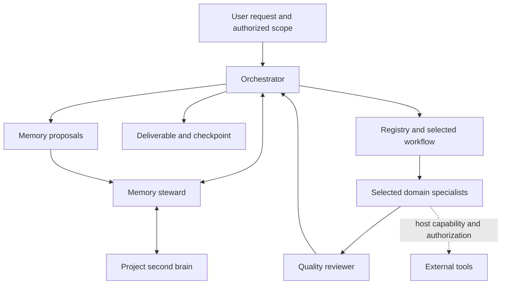

# Architecture

The control plane routes work and protects context boundaries. The knowledge plane holds project memory. The execution plane is supplied by the host: one chat, a coding assistant, or an agent runtime with real tools.

## Role model

The 16 specialists follow Foundation F1–F7, Operations O1–O6 and Intelligence & Growth G1–G3. Each role owns one domain but can invoke additional skills assigned through the registry. Orchestrator, reviewer and memory steward are control roles, not new marketing domains.

An agent is a responsibility and work-order contract. A skill is a reusable method that can evolve independently. A workflow is a dependency graph over agent roles. A run is a project-specific execution record pinned to concrete definitions. A second-brain record is knowledge or a decision, not an executable instruction.

## Context budget

Discover through registry metadata. Retrieve project context by relevance and status. Load selected agent profiles and skill bodies; load detailed domain references only when needed. Do not send all 540 capabilities and the entire brand history to every worker. Export bundles contain the selected workflow's roles and references, with a size estimate; the receiving host must check its own context limit.

## Memory lifecycle

Source → evidence → interpretation → proposal → authorized decision → approved active version → use in work → observed result → new proposal.

The JSON record store is authoritative in the reference implementation. A search index, graph view or external database can be derived from it. Every integration must retain project isolation, source traceability, history, conflicts and explicit authorization boundaries.

## Runtime semantics

`plan` creates a dependency graph with pinned content hashes. `complete-step` validates scope, required fields, declared execution mode and completed dependencies. A failed review blocks downstream steps. Definition changes require a new run or an explicit migration. These are deterministic checks; output quality is evaluated by the reviewer and the user.

The CLI writes local files and never runs arbitrary commands from memory, skills or registry data. It does not perform external side effects. File locks serialize utility writes; direct manual edits are outside those controls. Use access control and backups appropriate to the real deployment.

## Persistence and portability

Chat-only operation uses an exported snapshot and explicit checkpoint. File-capable operation maintains local project records. Delegated operation uses the same contracts with host-created agents. Capabilities, credentials, permissions and external approvals must be established in the new host; they are never inherited merely by importing a bundle.
